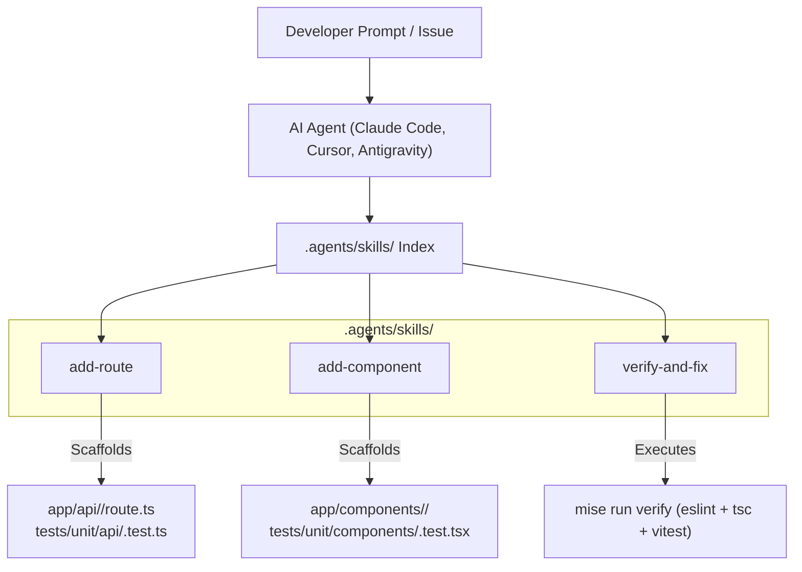

# Design: Agent Skills for cur8d TypeScript

## Architecture Overview



## Directory Structure

Skills will be placed in `.agents/skills/` to ensure immediate compatibility with `skills.sh`, Claude Code, Cursor, and other agent platforms:

```text
typescript/
├── .agents/
│   └── skills/
│       ├── add-route/
│       │   └── SKILL.md
│       ├── add-component/
│       │   └── SKILL.md
│       └── verify-and-fix/
│           └── SKILL.md
├── app/
├── tests/
├── package.json
└── mise.toml
```

## Skill Definitions

### 1. `add-route`
- **Frontmatter**:
  ```yaml
  ---
  name: add-route
  description: Scaffolds a new Next.js App Router API route or page with Zod validation, error handling, and Vitest tests. Use whenever asked to create, add, or implement an API endpoint or page.
  category: coding
  tags: [typescript, nextjs, react, api, cur8d]
  ---
  ```
- **Rules**:
  - Validates request payloads with Zod.
  - Returns structured `NextResponse.json(...)` with consistent status codes.
  - Adds unit/integration test in `tests/unit/api/`.

### 2. `add-component`
- **Frontmatter**:
  ```yaml
  ---
  name: add-component
  description: Scaffolds a new accessible React 19 UI component with Tailwind CSS styling and Vitest component tests. Use whenever asked to create, add, or build a UI component.
  category: coding
  tags: [typescript, react, tailwind, ui, a11y, cur8d]
  ---
  ```
- **Rules**:
  - Defaults to Server Components; marks `"use client"` only when client interactivity is required.
  - Adheres to WCAG 2.1 AA accessibility guidelines (semantic HTML, keyboard focus, ARIA labels).
  - Includes component test in `tests/unit/components/` using `@testing-library/react`.

### 3. `verify-and-fix`
- **Frontmatter**:
  ```yaml
  ---
  name: verify-and-fix
  description: Runs repository verification checks (pnpm lint, typecheck, test, test:e2e) and iteratively fixes TypeScript compiler errors and test failures. Use whenever asked to verify, test, or fix code quality issues.
  category: coding
  tags: [typescript, vitest, playwright, eslint, cur8d]
  ---
  ```
- **Rules**:
  - Runs `mise run verify` (or `pnpm lint`, `pnpm typecheck`, `pnpm test`).
  - Diagnoses and fixes compiler or test errors iteratively.
  - Preserves existing comments and architectural patterns.
